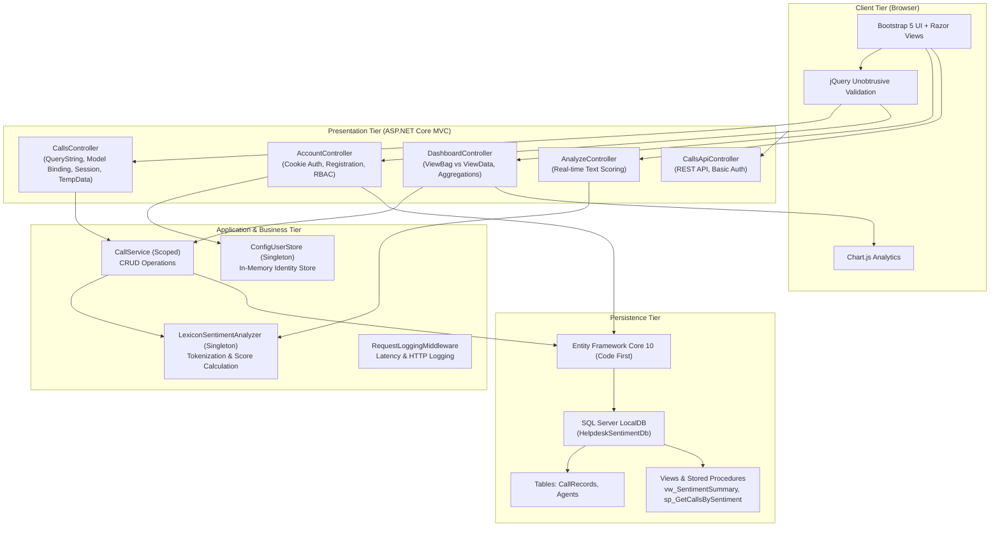

# INT402: Helpdesk Call Sentiment Analysis System
## Comprehensive Presentation Guide & Master Viva Examination Document

---

### Project Metadata
* **Course:** INT402 — Advanced .NET Technologies
* **Project Title:** Intelligent Helpdesk Call Sentiment Analysis & Monitoring Portal
* **Technology Stack:** .NET 10 (C# 13), ASP.NET Core MVC, Entity Framework Core 10, SQL Server LocalDB, Bootstrap 5, Chart.js, REST Web API
* **Target Role (Member 2):** **MVC Frontend Architect (`feature/mvc-ui`)** — *Priyanshu Tanwar*
* **Teammates:** Member 1 (Core & Database — *Nitesh*), Member 3 (API & Security — *Harshvardhan*)
* **Repository:** `https://github.com/Nitesh1123/HelpdeskSentiment`
* **Active PR:** [PR #6 on GitHub](https://github.com/Nitesh1123/HelpdeskSentiment/pull/6)
* **Local Server URL:** `http://localhost:5153`

---

## 1. Executive Summary & 60-Second Elevator Pitch

> *"Good morning/afternoon, professors. Our project is the **Helpdesk Call Sentiment Analysis System**, built on **.NET 10 and ASP.NET Core MVC**. 
>
> In modern call centers, supervisors cannot manually listen to hundreds of daily customer calls. Critical escalations, abusive churn risks, or frustrated customers often go unnoticed until it's too late.
>
> Our application solves this by automatically analyzing call transcripts using a rule-based sentiment engine. As soon as a call is logged, it evaluates the transcript, calculates a score between -1.0 and +1.0, tags it as Positive, Neutral, or Negative, and flags severe cases for immediate supervisor escalation.
>
> As **Member 2**, my responsibility was the entire **MVC Frontend Application**: designing the responsive UI, building all controllers (`CallsController`, `DashboardController`, `AnalyzeController`, `AccountController`), implementing client-side and server-side validation, managing state through `QueryString`, `TempData`, and `Session`, integrating Chart.js visual analytics, and building the user registration and authentication flow."*

---

## 2. System Architecture & Component Diagram



---

## 3. Slide-by-Slide Presentation Guide

Use this outline for your 8-to-10 slide presentation:

### Slide 1: Title & Team Introduction
* **Header:** Helpdesk Call Sentiment Analysis System
* **Course:** INT402 — Advanced .NET Technologies
* **Team Members & Responsibilities:**
  * **Member 1 (Nitesh):** Core Domain, OOP Sentiment Engine, EF Core Code First & SQL Server Scripts.
  * **Member 2 (Priyanshu Tanwar — YOU):** ASP.NET Core MVC Frontend, Razor Views, State Management, Validation, Chart.js Dashboard, User Registration.
  * **Member 3 (Harshvardhan):** Middleware Pipeline, Cookie & Basic Authentication, REST Web API.

### Slide 2: Problem Statement & Objectives
* **The Problem:** Call centers handle vast volumes of audio/text transcripts. High-churn customers and angry callers are buried in logs without real-time prioritization.
* **Our Solution:**
  1. Automated lexicon sentiment scoring upon call logging.
  2. Immediate alert banners and automated escalation flags for negative calls.
  3. Interactive supervisor analytics dashboard with charts.
  4. Role-based access control protecting supervisor dashboards and call deletions.

### Slide 3: Technical Stack & Architecture
* **Framework:** .NET 10 SDK (C# 13)
* **Architecture Pattern:** Model-View-Controller (MVC) + Layered Service Architecture
* **Database:** Microsoft SQL Server LocalDB via Entity Framework Core 10 (Code First)
* **Frontend:** Razor View Engine, Bootstrap 5, Bootstrap Icons, Chart.js
* **Validation:** Data Annotations, jQuery Validation + Unobtrusive, Controller `ModelState`

### Slide 4: Member 2 Deep-Dive — MVC Controllers & State Management
* **`CallsController`:**
  * Filter calls via URL **QueryString** (`?sentiment=Negative&search=refund`).
  * Model binding with `[Bind]` attribute to protect against **Overposting Attacks**.
  * **`TempData`:** Displays one-time dismissible alert banners across HTTP 302 redirects (Post/Redirect/Get pattern).
  * **`Session`:** Stores recent call IDs in user session state (`HttpContext.Session`) for the "Recently Viewed" sidebar.
* **`DashboardController`:**
  * Compares **`ViewBag`** (dynamic property access) and **`ViewData`** (dictionary access) pointing to the same underlying dictionary.
  * Supplies aggregated metrics to interactive Chart.js widgets.

### Slide 5: Member 2 Deep-Dive — UI Design, Validation & Security
* **Defense-in-Depth Validation:**
  * **Client-side:** Instant feedback via HTML5 `data-val-*` and unobtrusive jQuery (no network latency).
  * **Server-side:** `ModelState.IsValid` in C# controllers to ensure data integrity even if scripts are disabled.
* **User Registration & RBAC:**
  * Self-contained registration form with password confirmation (`[Compare]`) and duplicate checks.
  * **Privilege Escalation Prevention:** Public registration strictly creates `Agent` accounts. Supervisor (`Admin`) access requires authorized administrative credentials.
  * Automatic synchronization between `UserStore` and the SQL Server `Agents` table.

### Slide 6: Sentiment Studio Playground (`/Analyze`)
* Live playground for customer service agents.
* Type or paste any customer dialogue: computes sentiment score (-1.00 to +1.00), displays word match breakdown, and previews escalation triggers before saving.

### Slide 7: Live Demonstration (Transition to Browser)
* *(Follow the step-by-step demo script in Section 4).*

### Slide 8: Conclusion & Future Scope
* **Achievements:** 100% C# .NET 10 solution, zero third-party security vulnerabilities, zero build warnings, clean separation of concerns.
* **Future Work:** Cloud deployment on Azure App Service, Speech-to-Text audio transcription pipeline, ASP.NET Core Identity with SQL Server storage.

---

## 4. Live Project Demo Script (Step-by-Step)

Follow these exact steps during your practical presentation:

```
Step 1: Home Page (http://localhost:5153)
  - Show the hero banner, clean navbar, and system active status badge.
  - Explain that unauthenticated visitors can view the landing page but protected sections require authentication.

Step 2: Sign In & Quick Access Profiles (http://localhost:5153/Account/Login)
  - Show the clean sign-in card.
  - Click the quick profile chip "Support Agent" (fills agent / Agent@123).
  - Sign in: redirected to /Calls.

Step 3: User Registration (http://localhost:5153/Account/Register)
  - Sign out, then click "Create account".
  - Demonstrate Client-Side Validation: Click "Register" with empty fields -> red error messages appear instantly.
  - Type mismatched passwords -> shows "The password and confirmation password do not match."
  - Fill valid agent details (e.g. Vikas Sharma / vikas / vikas@helpdesk.local / Secure@123).
  - Submit -> redirected to /Calls with a green welcome alert banner:
    "Welcome to Helpdesk Support Portal, Vikas Sharma!"
  - Point to top right navbar: displays "Vikas Sharma [Agent]".
  - Explain: "Notice our security control: new users are strictly created as Agents. Only authorized credentials have Admin rights."

Step 4: Calls List & QueryString Filter (http://localhost:5153/Calls)
  - In the filter card, select Sentiment: "Negative" and enter Search: "refund".
  - Click "Filter". Point out the URL:
    /Calls?sentiment=Negative&search=refund
  - Explain: "The controller binds these query string parameters directly into nullable enum and string variables."
  - Show the table: red sentiment badges, escalation warning pills, and duration formatted in minutes.

Step 5: Call Details & Session State (http://localhost:5153/Calls/Details/1)
  - Click "View Details" on Call #1.
  - Highlight the full transcript, duration, sentiment score, and agent assignment.
  - Click "Back to calls". Look at the right sidebar:
    "Recently Viewed Calls" now displays Call #1 at the top of the list!
  - Explain: "This history is stored per visitor in HttpContext.Session as a cookie-backed session state."

Step 6: Log a Call Form & TempData (http://localhost:5153/Calls/Create)
  - Click "Log Call".
  - Point to the Agent dropdown: your newly registered agent ("Vikas Sharma") is listed!
  - Submit empty form -> server-side / client-side error spans highlight invalid fields.
  - Enter:
    - Caller Name: "Rajesh Kumar"
    - Phone: "9876543210" (valid 10 digits)
    - Transcript: "I am extremely angry and furious! My order was canceled and I want my money refunded immediately!"
    - Duration: 240
  - Click "Save & Run Sentiment Analysis".
  - Instantly redirected to Details: a yellow alert banner appears:
    "Call from Rajesh Kumar saved. Detected sentiment: Negative (-0.65) — flagged for escalation!"
  - Refresh the page: the alert banner disappears!
  - Explain: "That is TempData in action. It persists for exactly one redirect and automatically clears."

Step 7: Sentiment Studio (http://localhost:5153/Analyze)
  - Open "Sentiment Studio" from the navbar.
  - Click the quick test chip: "Billing Frustration".
  - Click "Evaluate Sentiment".
  - Show the live gauge, score (-0.67), matched negative keywords ("worst", "angry", "terrible"), and escalation recommendation.

Step 8: Supervisor Dashboard & Chart.js (http://localhost:5153/Dashboard)
  - While logged in as an Agent, attempt to navigate to /Dashboard.
  - Show that access is blocked with "Access denied" because the controller has [Authorize(Roles = "Admin")].
  - Log out and log in as "admin / Admin@123".
  - Navigate to /Dashboard:
    - Total calls, average sentiment, escalation counts.
    - Interactive Chart.js donut chart showing sentiment distribution.
    - Bar charts for category breakdown and agent score averages.
    - Top escalated calls table.
  - Explain: "ViewBag and ViewData deliver these aggregated metric dictionaries to the view to power Chart.js."

Step 9: REST Web API (/api/calls)
  - Show /api/calls in the browser or Postman with Basic Auth (admin:Admin@123).
  - Returns clean JSON serialization of call records without entity leaks.
```

---

## 5. Master Viva Questions & Model Answers

### A. MVC Architecture & Controllers

#### Q1: What is Model Binding in ASP.NET Core, and how does it prevent Overposting?
* **Answer:** Model binding is the mechanism that automatically maps incoming HTTP request data (form fields, route values, query strings) into C# action parameters and strongly-typed objects.
* To prevent **Overposting (Mass Assignment Attacks)**, we use the `[Bind("CallerName,PhoneNumber,Category,AgentId,Transcript,CallTime,DurationSeconds")]` attribute on `CallsController.Create`. This ensures malicious clients cannot manipulate computed fields like `SentimentScore`, `Sentiment`, or `IsEscalated` by injecting extra form keys.

#### Q2: What is `ModelState`, and what happens when `ModelState.IsValid` is false?
* **Answer:** `ModelState` represents the collection of submitted form values and validation state resulting from data annotations.
* When `ModelState.IsValid` is `false`, the controller reloads dropdown dependencies (`LoadAgentsAsync`) and returns `View(call)`. The form redisplays with the user's previously entered data intact, and `<span asp-validation-for="...">` tag helpers render the corresponding validation error messages.

#### Q3: Explain the difference between `ViewBag`, `ViewData`, and `TempData`.
* **Answer:**
  * **`ViewData`:** A dictionary (`ViewDataDictionary<string, object>`) accessible for the current request. Requires explicit typecasting when reading non-string objects.
  * **`ViewBag`:** A dynamic wrapper around the exact same `ViewData` dictionary (`ViewBag.Score` accesses `ViewData["Score"]`). No explicit casting needed, but lacks compile-time type safety.
  * **`TempData`:** Backed by session or encrypted cookies. Persists data across **exactly one subsequent request**, making it ideal for passing flash notification messages across HTTP 302 redirects in the Post/Redirect/Get pattern.

#### Q4: How is `Session` configured and utilized in this project?
* **Answer:** Session state is registered in `Program.cs` via `builder.Services.AddDistributedMemoryCache()` and `builder.Services.AddSession()`, with the middleware `app.UseSession()` inserted after `UseRouting()` and before `UseAuthorization()`.
* In `CallsController`, when a user inspects call details, `RememberRecentCall(id)` serializes a list of call IDs into a comma-separated string in `HttpContext.Session.SetString("RecentCalls", ...)`. When viewing `/Calls`, the sidebar deserializes these IDs to render recently viewed call links.

#### Q5: What is the Post/Redirect/Get (PRG) pattern, and why is it essential?
* **Answer:** PRG is an architectural pattern where an HTTP POST action, upon successful data processing, issues an HTTP 302 redirect (`RedirectToAction`) to a GET endpoint instead of returning a view directly.
* **Why it matters:** If the user presses F5 (refresh) after submitting a form, returning a view directly causes the browser to prompt *"Confirm Form Resubmission"* and potentially duplicates the record in the database. PRG ensures a page refresh simply re-executes the safe GET request.

---

### B. Views, Layouts, & Razor Syntax

#### Q6: What is the purpose of `_Layout.cshtml`, `_ViewStart.cshtml`, and `_ViewImports.cshtml`?
* **Answer:**
  * **`_Layout.cshtml`:** The master layout template defining the common HTML skeleton (navigation bar, CSS/JS links, flash messages, container, and footer). Contains `@RenderBody()` where child views are injected.
  * **`_ViewStart.cshtml`:** Executes before each view renders; it specifies the default layout (`Layout = "_Layout";`) so individual views do not need to repeat it.
  * **`_ViewImports.cshtml`:** Specifies shared Razor namespaces, tag helpers (`@addTagHelper *, Microsoft.AspNetCore.Mvc.TagHelpers`), and models across all views.

#### Q7: What are Partial Views, and why did you use `@section Scripts`?
* **Answer:**
  * **Partial Views:** Reusable Razor markup components rendered with `<partial name="..." />`. We use `_SentimentBadge.cshtml` to ensure sentiment pills render with identical badge styling and icons across `/Calls`, `/Calls/Details`, and `/Dashboard`.
  * **`@section Scripts`:** Views contain scripts (such as Chart.js init or validation bundles) that depend on jQuery and Bootstrap. If placed directly in the view body, they would execute before jQuery loads in the layout. By placing them in `@section Scripts { ... }`, Razor defers their output to `@await RenderSectionAsync("Scripts", required: false)` right before the closing `</body>` tag.

---

### C. Validation & Security

#### Q8: Compare Client-Side vs. Server-Side Validation. Can we rely only on Client-Side?
* **Answer:**
  * **Client-Side:** Tag Helpers convert model annotations (`[Required]`, `[StringLength]`, `[Compare]`) into HTML5 `data-val-*` attributes. `jquery.validate.unobtrusive.js` evaluates rules in the browser before network transmission.
  * **Server-Side:** Controller checks `ModelState.IsValid`.
  * **Never rely solely on client-side:** Client-side validation can be bypassed effortlessly by disabling JavaScript, using Postman/curl, or intercepting the request with an HTTP proxy. Server-side validation is our **mandatory security boundary**; client-side validation is purely for user experience.

#### Q9: How does the application prevent Privilege Escalation during user registration?
* **Answer:** In `AccountController.Register`, the role is hardcoded to `const string assignedRole = Roles.Agent;`. The `RegisterViewModel` intentionally excludes any role input fields. Even if an attacker injects a `Role=Admin` key into the HTTP POST body, the model binder ignores it and the controller enforces the `Agent` role. Supervisor accounts (`admin`) can only be provisioned through secure application configuration.

#### Q10: How does Cookie Authentication work in your MVC application?
* **Answer:** In `Program.cs`, we register `AddAuthentication(CookieAuthenticationDefaults.AuthenticationScheme).AddCookie(...)`.
* When credentials are validated, `_users.CreatePrincipal(user)` builds a `ClaimsPrincipal` containing claims for `NameIdentifier`, `Name`, and `Role`. Calling `HttpContext.SignInAsync(...)` encrypts these claims into an HTTP-only, secure `.AspNetCore.Cookies` cookie transmitted in response headers. Subsequent requests send this cookie, which the `UseAuthentication()` middleware decrypts to populate `HttpContext.User`.

---

### D. Dependency Injection, Database, & EF Core

#### Q11: What service lifetimes are available in ASP.NET Core, and which did you choose?
* **Answer:**
  1. **Transient:** Created each time requested (`AddTransient`).
  2. **Scoped:** Created once per HTTP request (`AddScoped`).
  3. **Singleton:** Created once on application start and shared across all requests (`AddSingleton`).
* **In our project:**
  * `ISentimentAnalyzer` is registered as **Singleton** because it is stateless (lexicon dictionary lookup with no per-user state).
  * `ICallService` and `HelpdeskDbContext` are registered as **Scoped** because EF Core `DbContext` instances are not thread-safe and must be disposed at the end of each HTTP request.
  * `IUserStore` is registered as **Singleton** to maintain the in-memory user registry across the lifetime of the application.

#### Q12: What is the difference between Code First and Database First in EF Core?
* **Answer:**
  * **Code First (Used by our app):** C# entity classes (`CallRecord`, `Agent`) and `HelpdeskDbContext` are written first. Running `dotnet ef migrations add` generates C# migration code, and `db.Database.Migrate()` automatically creates/updates SQL Server tables, keys, and foreign key constraints on startup.
  * **Database First:** Database tables and constraints are created directly in SQL Server using T-SQL DDL scripts (`01_Tables.sql`). The EF Core command `dotnet ef dbcontext scaffold` generates entity classes from the existing schema. We include SQL scripts in `Database/` to demonstrate both syllabus approaches.

---

## 6. Quick Cheat Sheet for the Viva Table

Print or keep this quick reference handy during your evaluation:

| Parameter / Concept | Implementation in HelpdeskSentiment |
| :--- | :--- |
| **Framework & Language** | .NET 10 SDK / C# 13 |
| **Authentication Scheme** | Cookies for MVC (`/Account/Login`), HTTP Basic for REST API (`/api/*`) |
| **State Management Mechanisms** | QueryString (filtering), TempData (alerts), Session (recent calls), Cookies (auth), ViewBag/ViewData (dashboard metrics) |
| **Default Supervisor Credentials** | `admin` / `Admin@123` (Full Admin access to Dashboard & deletions) |
| **Default Agent Credentials** | `agent` / `Agent@123` (Access to call logging, review, and live studio) |
| **Database Server & Name** | `(localdb)\MSSQLLocalDB` / `HelpdeskSentimentDb` |
| **Active GitHub Branch & PR** | `feature/mvc-ui` -> [PR #6](https://github.com/Nitesh1123/HelpdeskSentiment/pull/6) |
| **Local Application Port** | `http://localhost:5153` |
| **Sentiment Calculation Range** | `-1.00` (Max Negative) to `+1.00` (Max Positive); threshold `< -0.3` flags escalation |
