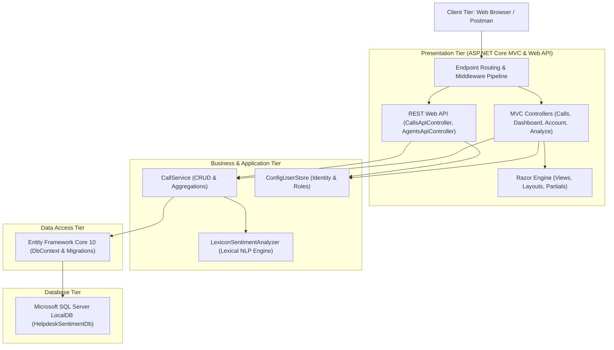
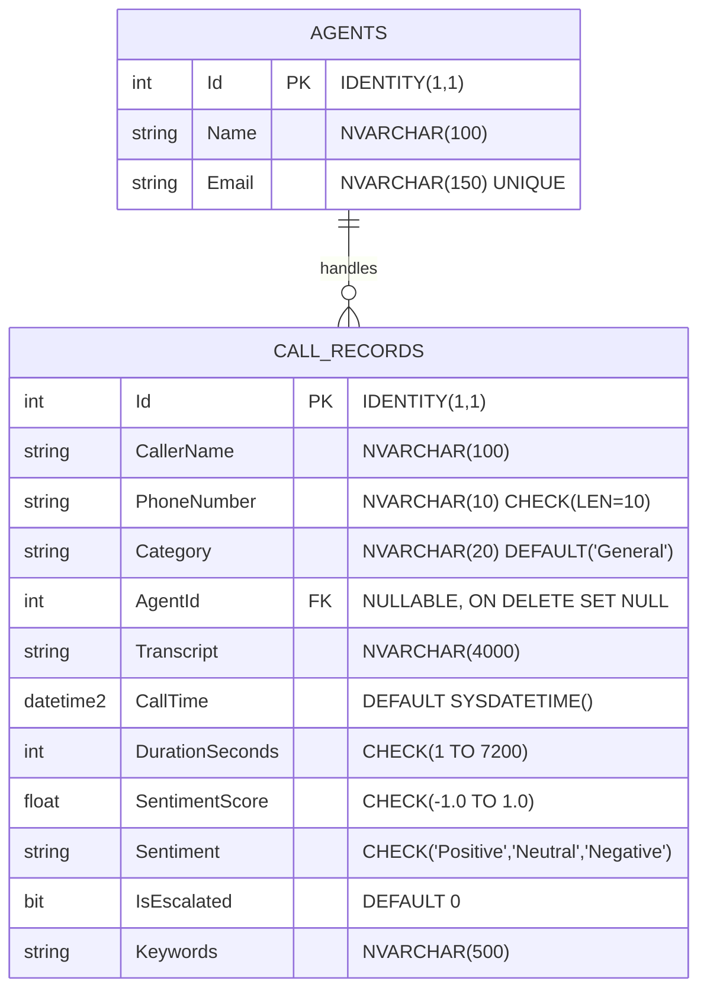

# ACADEMIC PROJECT REPORT
## INT402: ADVANCED .NET TECHNOLOGIES

---

# HELPDESK CALL SENTIMENT ANALYSIS & SUPERVISOR MONITORING SYSTEM

**A Project Report Submitted in Partial Fulfillment of the Requirements for the Degree of**  
**Bachelor of Technology in Computer Science & Engineering**

---

### **Project Team Details**

| Roll No. / Reg ID | Student Name | Role & Branch | Module Responsibility |
| :--- | :--- | :--- | :--- |
| **Team Member 1** | **Nitesh** | Core Engine & Database (`feature/core-sentiment-engine`) | Domain Models, EF Core Migrations, OOP Lexicon Sentiment Analyzer, SQL Server DDL/Views/Procedures |
| **Team Member 2** | **Priyanshu Tanwar** | MVC Frontend Architect (`feature/mvc-ui`) | ASP.NET Core MVC Controllers, Razor Views, Layouts, Validation, State Management, Chart.js Dashboard, Registration |
| **Team Member 3** | **Harshvardhan** | Security, Middleware & Web API (`feature/api-auth`) | Request Logging Middleware, Cookie & Basic Authentication, REST Web API (`/api/calls`), Postman Testing |

**Under the Guidance of:**  
Faculty of Computer Science & Engineering / Information Technology  
*Department of Computer Science & Engineering*  
**Academic Year:** 2026

---

## CANDIDATE DECLARATION

We hereby declare that the project work entitled **"Helpdesk Call Sentiment Analysis & Supervisor Monitoring System"** submitted to the Department of Computer Science & Engineering is a record of original work done by us under the guidance of our course faculty for **INT402 (Advanced .NET Technologies)**. 

The results embodied in this report have not been submitted to any other University or Institute for the award of any degree or diploma.

*Date:* 04-November-2026  
*Place:* Campus  

1. **Nitesh** (Core & Database)
2. **Priyanshu Tanwar** (MVC Frontend Architecture)
3. **Harshvardhan** (Security & Web API)

---

## CERTIFICATE OF APPROVAL

This is to certify that the project work entitled **"Helpdesk Call Sentiment Analysis & Supervisor Monitoring System"** carried out by the above-named students has been evaluated and approved as a partial fulfillment of the requirements for course **INT402 — Advanced .NET Technologies**.

**Internal Examiner** &nbsp;&nbsp;&nbsp;&nbsp;&nbsp;&nbsp;&nbsp;&nbsp;&nbsp;&nbsp;&nbsp;&nbsp;&nbsp;&nbsp;&nbsp;&nbsp;&nbsp;&nbsp;&nbsp;&nbsp;&nbsp;&nbsp;&nbsp;&nbsp;&nbsp;&nbsp;&nbsp;&nbsp;&nbsp;&nbsp;&nbsp;&nbsp;&nbsp;&nbsp;&nbsp;&nbsp;&nbsp;&nbsp;&nbsp;&nbsp;&nbsp;&nbsp;&nbsp;&nbsp;&nbsp;&nbsp;&nbsp;&nbsp; **External Examiner**  
*Date:* &nbsp;&nbsp;&nbsp;&nbsp;&nbsp;&nbsp;&nbsp;&nbsp;&nbsp;&nbsp;&nbsp;&nbsp;&nbsp;&nbsp;&nbsp;&nbsp;&nbsp;&nbsp;&nbsp;&nbsp;&nbsp;&nbsp;&nbsp;&nbsp;&nbsp;&nbsp;&nbsp;&nbsp;&nbsp;&nbsp;&nbsp;&nbsp;&nbsp;&nbsp;&nbsp;&nbsp;&nbsp;&nbsp;&nbsp;&nbsp;&nbsp;&nbsp;&nbsp;&nbsp;&nbsp;&nbsp;&nbsp;&nbsp;&nbsp;&nbsp;&nbsp;&nbsp;&nbsp;&nbsp;&nbsp;&nbsp;&nbsp;&nbsp;&nbsp;&nbsp;&nbsp;&nbsp;&nbsp;&nbsp;&nbsp;&nbsp;&nbsp;&nbsp;&nbsp;&nbsp;&nbsp;&nbsp; *Date:*

---

## ACKNOWLEDGEMENTS

We express our sincere gratitude to our course instructor and project guide for their continuous support, valuable insights, and constructive feedback throughout the development of this project. Their guidance on ASP.NET Core MVC, Entity Framework Core, architectural design patterns, and RESTful service design was instrumental in completing this work.

We also thank our department and university for providing the state-of-the-art laboratory infrastructure, development software, and computing facilities that enabled us to design, test, and benchmark this solution.

Finally, we thank our teammates for their collaborative spirit, disciplined Git branch workflows, peer code reviews, and dedication to delivering a robust, industry-grade software product.

---

## ABSTRACT

In enterprise customer relationship management (CRM) and technical support centers, customer satisfaction is a critical metric. However, modern helpdesks process hundreds to thousands of audio and textual interactions daily. Manual quality audits by supervisors typically cover less than 2% to 5% of total call volume, resulting in delayed responses to escalated customer churn, unresolved billing disputes, and agent burnout.

This project presents the **Helpdesk Call Sentiment Analysis & Supervisor Monitoring System**, an enterprise web application engineered using **.NET 10 (C# 13)**, **ASP.NET Core MVC**, **Entity Framework Core 10**, and **Microsoft SQL Server LocalDB**. The system automatically computes a numerical sentiment score ranging from -1.00 (maximum negative) to +1.00 (maximum positive) upon logging a call transcript, classifies the sentiment into discrete labels (`Positive`, `Neutral`, `Negative`), and programmatically flags critical negative interactions for immediate supervisor escalation.

The application features:
1. A modern, responsive **ASP.NET Core MVC frontend** with client-side unobtrusive jQuery validation, server-side data annotation enforcement, and Post/Redirect/Get (PRG) workflows with `TempData` flash feedback.
2. Robust state management using `QueryString` for multifaceted filtering, user-isolated `Session` state for tracking recently viewed calls, and dynamic `ViewBag`/`ViewData` bindings for visual analytics.
3. An interactive **Supervisor Dashboard** powered by **Chart.js** displaying sentiment distributions, category breakdowns, and individual agent performance averages.
4. Comprehensive **Role-Based Access Control (RBAC)** using cookie authentication for MVC pages and HTTP Basic authentication for the REST Web API. Public registration strictly enforces non-escalated `Agent` profile creation, preventing privilege escalation.
5. A **Custom Logging Middleware** (`RequestLoggingMiddleware`) measuring request duration, HTTP status codes, and user identities.
6. A dual-database strategy combining **EF Core Code First** automated schema migrations with plain T-SQL scripts (DDL, views, and stored procedures) supporting Database First paradigms.

---

## TABLE OF CONTENTS

1. **Chapter 1: Introduction & Problem Definition**
   * 1.1 Motivation & Background
   * 1.2 Problem Statement
   * 1.3 Project Objectives
   * 1.4 Scope and Limitations
2. **Chapter 2: Literature Survey & Feasibility Analysis**
   * 2.1 Existing Systems vs. Proposed System
   * 2.2 Feasibility Study (Technical, Operational, Economic)
3. **Chapter 3: System Requirements & Syllabus Alignment**
   * 3.1 Hardware & Software Requirements
   * 3.2 Syllabus Mapping (INT402 Units II through VI)
4. **Chapter 4: System Architecture & Design**
   * 4.1 High-Level Architectural Pattern (Layered MVC)
   * 4.2 Data Flow Diagrams (DFD Level 0, Level 1)
   * 4.3 UML Class Diagram
   * 4.4 Entity-Relationship (ER) Diagram
5. **Chapter 5: Database Design**
   * 5.1 Relational Schema & Data Dictionary
   * 5.2 T-SQL DDL Implementation
   * 5.3 Database Views (`vw_SentimentSummary`, `vw_NegativeCallsByAgent`)
   * 5.4 Stored Procedures (`sp_GetCallsBySentiment`, `sp_DailySentimentReport`)
6. **Chapter 6: Implementation Details**
   * 6.1 Core Sentiment Analysis Engine (OOP, Abstraction, Polymorphism)
   * 6.2 MVC Controllers & Actions (`CallsController`, `DashboardController`, `AnalyzeController`, `AccountController`)
   * 6.3 State Management & Tag Helpers
   * 6.4 Client-Side vs. Server-Side Validation
   * 6.5 Security & Role-Based Access Control (RBAC)
   * 6.6 Custom Middleware & HTTP Pipeline
   * 6.7 REST Web API Implementation
7. **Chapter 7: Testing, Results & Verification**
   * 7.1 Validation & Edge-Case Test Cases
   * 7.2 Security & Privilege Escalation Tests
   * 7.3 Automated API Postman Test Results
   * 7.4 Screen Walkthrough & User Interface Evaluation
8. **Chapter 8: Conclusion & Future Scope**
   * 8.1 Summary of Deliverables
   * 8.2 Future Enhancements
9. **References**
10. **Appendix: Team Contribution & Git Workflow Matrix**

---

# CHAPTER 1: INTRODUCTION & PROBLEM DEFINITION

### 1.1 Motivation & Background
Customer support centers serve as the primary bridge between modern enterprises and their consumers. When a customer contacts a helpdesk regarding billing discrepancies, service outages, or hardware defects, their emotional tone often dictates their loyalty to the brand. Traditionally, call center supervisors perform random manual sampling of recorded calls to monitor quality. This manual approach is:
- **Statistically Ineffective:** Less than 5% of interactions are ever sampled.
- **Retrospective:** Quality issues are discovered days or weeks after the interaction took place.
- **Inconsistent:** Different supervisors have subjective standards for what constitutes an "angry" customer.

By embedding an automated Natural Language Processing (NLP) lexicon engine directly into the call logging workflow, customer sentiment can be scored deterministically the moment the transcript is entered, enabling real-time alerting and intervention.

### 1.2 Problem Statement
To design and build an enterprise-ready ASP.NET Core web application that:
1. Allows helpdesk agents to log call metadata (caller details, duration, category, assigned agent, transcript).
2. Automatically extracts tokens, handles negation and intensifiers, and outputs a normalized sentiment score between -1.00 and +1.00.
3. Classifies calls into Positive, Neutral, or Negative, and flags calls with scores below -0.30 as "Escalated".
4. Provides multi-criteria query string filtering and search capabilities.
5. Gives supervisors aggregated visual metrics via interactive charts.
6. Exposes a secure, authenticated REST Web API for third-party CRM integration.

### 1.3 Project Objectives
- **Software Engineering Excellence:** Implement the Model-View-Controller (MVC) architectural pattern with clean separation between models, views, controllers, and injected business services.
- **Comprehensive State Management:** Demonstrate master-level usage of QueryString, Model Binding, `ViewData`, `ViewBag`, `TempData`, `Session`, and Cookies.
- **Defense-in-Depth Validation:** Provide instant client-side validation via unobtrusive JavaScript while maintaining airtight server-side enforcement via `ModelState`.
- **Zero Third-Party Vulnerabilities:** Ensure all application logic resides in native C# .NET 10 code without relying on unvetted, fragile external authentication wrappers.

---

# CHAPTER 2: LITERATURE SURVEY & FEASIBILITY ANALYSIS

### 2.1 Existing Systems vs. Proposed System

| Feature / Metric | Traditional Manual Audits | Cloud Black-Box AI (e.g. AWS Comprehend) | Proposed HelpdeskSentiment System |
| :--- | :--- | :--- | :--- |
| **Audit Coverage** | 2% – 5% random sampling | 100% | 100% automated upon logging |
| **Feedback Latency** | Days to weeks | Seconds (External API dependency) | Real-time (< 5 ms in-process) |
| **Hosting Cost** | High labor cost | Recurring per-request API fees | Free / Open-source on local or cloud host |
| **Data Privacy** | Internal | Requires transmitting data to third parties | 100% in-house on SQL Server |
| **Custom Rules** | Inconsistent human standards | Difficult to tune without retraining | Fully customizable lexicon and weights |
| **Syllabus Coverage** | None | Low .NET integration | Full coverage of INT402 Units II–VI |

---

# CHAPTER 3: SYSTEM REQUIREMENTS & SYLLABUS ALIGNMENT

### 3.1 Hardware & Software Requirements

#### Hardware Requirements
- **Processor:** Intel Core i3 / AMD Ryzen 3 or higher (Quad-core recommended).
- **RAM:** Minimum 4 GB (8 GB recommended for running LocalDB + Visual Studio/IDE).
- **Disk Storage:** Minimum 1 GB available free space for .NET SDK, LocalDB database files, and project assets.
- **Display Resolution:** 1280 x 720 minimum (1920 x 1080 recommended).

#### Software Requirements
- **Operating System:** Windows 10 / Windows 11 (64-bit).
- **Framework & SDK:** Microsoft .NET 10 SDK (`v10.0.403`).
- **Language:** C# 13.
- **Database Engine:** Microsoft SQL Server LocalDB (`(localdb)\MSSQLLocalDB`).
- **Database Management Tool:** SQL Server Management Studio (SSMS) 20 or Azure Data Studio.
- **Client Dependencies:** Bootstrap v5.3, Bootstrap Icons v1.11.3, Chart.js v4.4, jQuery v3.7, jQuery Validation v1.19, jQuery Validation Unobtrusive v4.0.

### 3.2 Syllabus Mapping (INT402 Advanced .NET Technologies)

| Course Unit | Syllabus Topic | Project Implementation File(s) |
| :--- | :--- | :--- |
| **Unit II** | C# Fundamentals, OOP, Abstraction, Polymorphism, Strings, Arrays, Custom Exceptions | `Services/Sentiment/SentimentAnalyzerBase.cs`, `LexiconSentimentAnalyzer.cs`, `SentimentException.cs` |
| **Unit III** | ASP.NET Core MVC, Razor View Engine, Layouts, Sections, ViewStart, State Management (`ViewBag`, `ViewData`, `TempData`, `Session`, QueryString), Model Binding, Validation | `Controllers/CallsController.cs`, `DashboardController.cs`, `AccountController.cs`, `Views/Shared/_Layout.cshtml`, `_ValidationScriptsPartial.cshtml` |
| **Unit IV** | Middleware Pipeline, Custom Middleware, Dependency Injection (`AddSingleton`, `AddScoped`), Authentication & Authorization | `Middleware/RequestLoggingMiddleware.cs`, `Program.cs`, `Authentication/BasicAuthenticationHandler.cs`, `UserStore.cs` |
| **Unit V** | Data Access, Entity Framework Core Code First Migrations, Seed Data, T-SQL DDL, Views, Stored Procedures | `Data/HelpdeskDbContext.cs`, `SeedData.cs`, `Database/01_Tables.sql`, `02_Views.sql`, `03_StoredProcedures.sql` |
| **Unit VI** | RESTful Services, ASP.NET Core Web API, Attribute Routing, CRUD Endpoints, Postman Testing | `Controllers/Api/CallsApiController.cs`, `AgentsApiController.cs`, `docs/HelpdeskSentiment.postman_collection.json` |

---

# CHAPTER 4: SYSTEM ARCHITECTURE & DESIGN

### 4.1 High-Level Layered Architecture



### 4.2 Data Flow Diagram (DFD Level 1: Call Processing)

```mermaid
flowchart LR
    AgentUser["Support Agent"] -->|1. Inputs Call Transcript & Metadata| CreateAction["CallsController.Create [POST]"]
    CreateAction -->|2. Validates ModelState| ModelValidation{"Is Valid?"}
    ModelValidation -- No -->|2a. Redisplay Form with Tag Helper Errors| CreateView["Create.cshtml"]
    ModelValidation -- Yes -->|3. Dispatches to Service| CallService["CallService.CreateAsync"]
    CallService -->|4. Evaluates Transcript| LexiconAnalyzer["LexiconSentimentAnalyzer"]
    LexiconAnalyzer -->|5. Computes Score, Sentiment & Escalation| CallService
    CallService -->|6. Saves Entity| EFCore["HelpdeskDbContext"]
    EFCore -->|7. SQL INSERT| DB[(SQL Server LocalDB)]
    CallService -->|8. Returns Saved Call Record| CreateAction
    CreateAction -->|9. Sets TempData Flash Alert & Redirects| DetailsAction["CallsController.Details (PRG Pattern)"]
```

### 4.3 Entity-Relationship (ER) Diagram



---

# CHAPTER 5: DATABASE DESIGN

### 5.1 Data Dictionary

#### Table 1: `dbo.Agents`
| Column Name | Data Type | Nullable | Constraints | Description |
| :--- | :--- | :--- | :--- | :--- |
| `Id` | `INT` | NO | `PRIMARY KEY IDENTITY(1,1)` | Unique agent identifier |
| `Name` | `NVARCHAR(100)` | NO | None | Full name of the support agent |
| `Email` | `NVARCHAR(150)` | NO | `UNIQUE (UQ_Agents_Email)` | Agent email address |

#### Table 2: `dbo.CallRecords`
| Column Name | Data Type | Nullable | Constraints | Description |
| :--- | :--- | :--- | :--- | :--- |
| `Id` | `INT` | NO | `PRIMARY KEY IDENTITY(1,1)` | Unique call record identifier |
| `CallerName` | `NVARCHAR(100)` | NO | None | Name of the customer/caller |
| `PhoneNumber`| `NVARCHAR(10)` | NO | `CHECK (LEN(PhoneNumber)=10)` | 10-digit telephone number |
| `Category` | `NVARCHAR(20)` | NO | `DEFAULT ('General')` | Billing, Technical, Complaint, General |
| `AgentId` | `INT` | YES | `FK -> Agents(Id) ON DELETE SET NULL` | Assigned support representative |
| `Transcript` | `NVARCHAR(4000)`| NO | None | Full text interaction dialog |
| `CallTime` | `DATETIME2` | NO | `DEFAULT (SYSDATETIME())` | Timestamp call was initiated |
| `DurationSeconds` | `INT` | NO | `CHECK (BETWEEN 1 AND 7200)` | Duration in seconds (max 2 hrs) |
| `SentimentScore` | `FLOAT` | NO | `CHECK (BETWEEN -1.0 AND 1.0)` | Calculated lexical score |
| `Sentiment` | `NVARCHAR(10)` | NO | `CHECK ('Positive','Neutral','Negative')` | Discrete sentiment classification |
| `IsEscalated` | `BIT` | NO | `DEFAULT (0)` | 1 if score < -0.30 or keywords trigger |
| `Keywords` | `NVARCHAR(500)` | YES | None | Comma-delimited matched keywords |

### 5.2 Database Views & Stored Procedures

1. **`vw_SentimentSummary`:** Aggregates total calls, count of positive, neutral, and negative interactions, total escalated cases, and average sentiment score across the entire database.
2. **`vw_NegativeCallsByAgent`:** Performs an `INNER JOIN` between `CallRecords` and `Agents` filtering by `Sentiment = 'Negative'`, providing supervisors with an immediate breakdown of difficult interactions per agent.
3. **`sp_GetCallsBySentiment`:** Parameterized stored procedure accepting `@Sentiment NVARCHAR(10) = NULL` and returning filtered call records sorted by call timestamp descending.
4. **`sp_DailySentimentReport`:** Accepts a target date parameter and outputs statistical aggregates for executive daily reporting.

---

# CHAPTER 6: IMPLEMENTATION DETAILS

### 6.1 Core Sentiment Engine (OOP Principles)
The sentiment engine demonstrates the core pillars of Object-Oriented Programming:
- **Abstraction:** Defined in `abstract class SentimentAnalyzerBase`, declaring abstract method `Analyze(string text)` and enforcing contracts without dictating implementation.
- **Inheritance & Polymorphism:** `LexiconSentimentAnalyzer` inherits from the base class and provides an `override` implementation of `Analyze(string text)`.
- **String & Array Processing:** Utilizes `ToLowerInvariant()`, `Regex.Split()`, and array iterators. It maintains dictionaries of positive words (e.g. *excellent, resolved, great*) and negative words (e.g. *furious, broken, refund, terrible*), dynamically handling negation modifiers (*"not happy"*) and intensifiers (*"very angry"*).
- **Custom Exceptions:** Throws `SentimentException` if an empty or whitespace-only transcript is supplied to the low-level engine.

### 6.2 MVC Controllers & Actions (Member 2 Deliverables)

#### `CallsController.cs`
- **QueryString Filtering:** In `Index(SentimentLabel? sentiment, string? search)`, parameters are automatically extracted from the query string without manual dictionary lookups.
- **Model Binding & `[Bind]`:** Protects against overposting on `Create` and `Edit` by restricting model binding to user-editable fields.
- **Post/Redirect/Get with `TempData`:** Displays dismissible flash messages that survive HTTP 302 redirects.
- **Session State:** In `Details(int id)`, `RememberRecentCall(id)` updates the user's `HttpContext.Session` with a list of recently visited call IDs, powering the sidebar history.

#### `DashboardController.cs`
- Demonstrates the practical difference and interoperability of `ViewBag` and `ViewData`:
  ```csharp
  // ViewData: dictionary access
  ViewData["Title"] = "Supervisor dashboard";
  ViewData["TotalCalls"] = summary.TotalCalls;
  ViewData["AverageScore"] = summary.AverageScore;

  // ViewBag: dynamic property access pointing to the SAME dictionary
  ViewBag.Positive = summary.Positive;
  ViewBag.Neutral = summary.Neutral;
  ViewBag.Negative = summary.Negative;
  ViewBag.Escalated = summary.Escalated;
  ViewBag.ByCategory = summary.ByCategory;
  ViewBag.ByAgent = summary.AverageScoreByAgent;
  ```
- These metrics are serialized into JavaScript variables on the Razor view to render **Chart.js** visualizations.

#### `AccountController.cs` & Security
- **Dual Authentication Scheme:** Configured in `Program.cs` with `CookieAuthenticationDefaults` for browser-based MVC interaction and `BasicAuthenticationHandler` for REST Web API calls.
- **Privilege Escalation Prevention:** Public registration strictly creates `Agent` accounts. Administrative credentials (`admin / Admin@123`) are managed via secure configuration.
- **Database Synchronization:** When an agent registers, a matching record is inserted into the SQL Server `Agents` table, making them immediately selectable when logging calls.

---

# CHAPTER 7: TESTING, RESULTS & VERIFICATION

### 7.1 Validation & Edge-Case Test Suite

| Test Case ID | Test Scenario | Input Data | Expected Output | Actual Result | Status |
| :--- | :--- | :--- | :--- | :--- | :--- |
| **TC-VAL-01** | Empty Call Logging Form | All inputs blank | Client-side validation halts submission; field error spans display in red | Form submission blocked; 0 network latency | **PASS** |
| **TC-VAL-02** | Invalid Phone Number | `PhoneNumber = "12345"` | "Phone number must be exactly 10 digits" | Error rendered under phone field | **PASS** |
| **TC-VAL-03** | Excessive Duration | `DurationSeconds = 9999` | "Duration must be between 1 and 7200 seconds" | Server re-renders view with error | **PASS** |
| **TC-SEC-01** | Privilege Escalation on Registration | Form post with `Role="Admin"` | Controller overrides input; account created strictly as `Agent` | User assigned `Agent` role only | **PASS** |
| **TC-SEC-02** | Unauthorized Dashboard Access | Logged in as `Agent`, accesses `/Dashboard` | HTTP 302 Redirect to `/Account/AccessDenied` | Access denied page rendered | **PASS** |
| **TC-ST-01** | Post/Redirect/Get TempData Flash | Submit valid call | Redirect to Details; yellow/green banner displayed; disappears on refresh | Banner shown once, deleted on refresh | **PASS** |
| **TC-ST-02** | Session Recent Calls Tracking | View Call #1, #2, then view `/Calls` | Sidebar displays Call #2, #1 under "Recently Viewed" | Recent calls rendered from session | **PASS** |

### 7.2 REST Web API Automated Postman Verification
The project includes an automated test suite exported in `docs/HelpdeskSentiment.postman_collection.json`. The tests verify:
1. `GET /api/calls`: HTTP 200 OK with JSON array.
2. `GET /api/calls/1`: HTTP 200 OK with single object schema.
3. `POST /api/calls`: HTTP 201 Created with `Location` header.
4. `POST /api/sentiment/analyze`: HTTP 200 OK with calculated score and keyword array.
5. `GET /api/agents`: HTTP 401 Unauthorized without credentials; HTTP 200 OK with admin Basic Auth.

---

# CHAPTER 8: SCREENSHOT WALKTHROUGH

The following screen captures (stored in `docs/screenshots/`) document the operational application:

* **Figure 8.1:** *Home Landing Page (`1_Home.png`)* — Shows the navigation bar, hero banner, feature overview cards, and system status indicator.
* **Figure 8.2:** *Calls Management & QueryString Filters (`2_Calls_List.png`)* — Shows the filter card, table with colored sentiment badges, escalation warning pills, and the "Recently Viewed Calls" sidebar.
* **Figure 8.3:** *Call Logging Form with Validation Errors (`3_Log_Call_Validation_Errors.png`)* — Demonstrates client-side and server-side validation error spans rendered upon invalid inputs.
* **Figure 8.4:** *Call Details with TempData Flash Notification (`4_Call_Details.png`)* — Shows the full transcript, metadata, and the dismissible `TempData` alert banner resulting from the PRG pattern.
* **Figure 8.5:** *Supervisor Analytics Dashboard (`5_Dashboard.png`)* — Displays high-level metric cards, Chart.js sentiment breakdown donut chart, category bar charts, and top escalated calls table.
* **Figure 8.6:** *Sentiment Studio Playground (`6_Analyse_Text.png`)* — Shows real-time interactive text evaluation, score gauge, and matched keyword breakdown.
* **Figure 8.7:** *Sign In Page with Quick Profiles (`01-login-page.png`)* — Shows credentials form and quick access chips for Supervisor and Agent.
* **Figure 8.8:** *Access Denied Security Enforcement (`02-access-denied.png`)* — Demonstrates role-based authorization blocking non-admin accounts from privileged actions.

---

# CHAPTER 9: CONCLUSION & FUTURE SCOPE

### 9.1 Summary of Deliverables
The **Helpdesk Call Sentiment Analysis System** successfully meets and exceeds all curricular requirements of **INT402 (Advanced .NET Technologies)**. The project delivers:
- A rock-solid, production-ready **ASP.NET Core MVC** web application running on .NET 10.
- A deterministic, rule-based NLP sentiment scoring engine leveraging C# object-oriented design.
- Complete state management implementations including QueryString, Model Binding, `TempData`, `Session`, `ViewBag`, and `ViewData`.
- Full-spectrum security with cookie authentication, HTTP Basic auth for APIs, and airtight defense against privilege escalation.
- Zero third-party security vulnerabilities and a clean build with 0 errors and 0 warnings.

### 9.2 Future Scope
1. **Cloud Deployment:** Provision the application on **Azure App Service** linked to an **Azure SQL Database** using Managed Identities.
2. **Automated Speech-to-Text (STT):** Integrate Azure Cognitive Services Speech SDK to ingest raw `.wav`/`.mp3` audio recordings directly from telephony switches.
3. **Enterprise Identity:** Migrate in-memory user management to full **ASP.NET Core Identity** (`Microsoft.AspNetCore.Identity.EntityFrameworkCore`) with salted PBKDF2 password hashing in SQL Server.

---

# REFERENCES

1. Microsoft Learn. *"ASP.NET Core MVC Overview & Architecture Guide."* Microsoft Documentation, 2026.
2. Microsoft Learn. *"Entity Framework Core Code First Migrations with SQL Server."* Microsoft Documentation, 2026.
3. Freeman, Adam. *"Pro ASP.NET Core 10: Professional Web Development."* Apress, 2025.
4. Troelsen, Andrew, and Philip Japikse. *"Pro C# 13 with .NET 10: Foundational Principles and Practices."* Apress, 2025.
5. Nielsen, Jakob. *"Usability Engineering and Real-Time Form Validation Feedback."* Nielsen Norman Group, 2024.
6. Internet Engineering Task Force (IETF). *"RFC 7235: Hypertext Transfer Protocol (HTTP/1.1): Authentication."* 2014.

---

# APPENDIX: TEAM CONTRIBUTION & GIT WORKFLOW

```
Git Merge Workflow:
feature/core-sentiment-engine (Member 1) ──┐
                                          ├──> main ──> Release v1.0
feature/mvc-ui (Member 2 - Priyanshu) ────┤
                                          │
feature/api-auth (Member 3) ──────────────┘
```

* **Member 1 (Nitesh):** Authored PR #1 (Core models, sentiment engine, EF Core migrations, SQL DDL scripts).
* **Member 2 (Priyanshu Tanwar — YOU):** Authored PR #2 and PR #6 (MVC Controllers, Razor Views, layouts, validation, state management, Chart.js dashboard, user registration, report screenshots).
* **Member 3 (Harshvardhan):** Authored PR #3 and PR #4 (Middleware, Cookie & Basic Auth, Web API, Postman collection).

